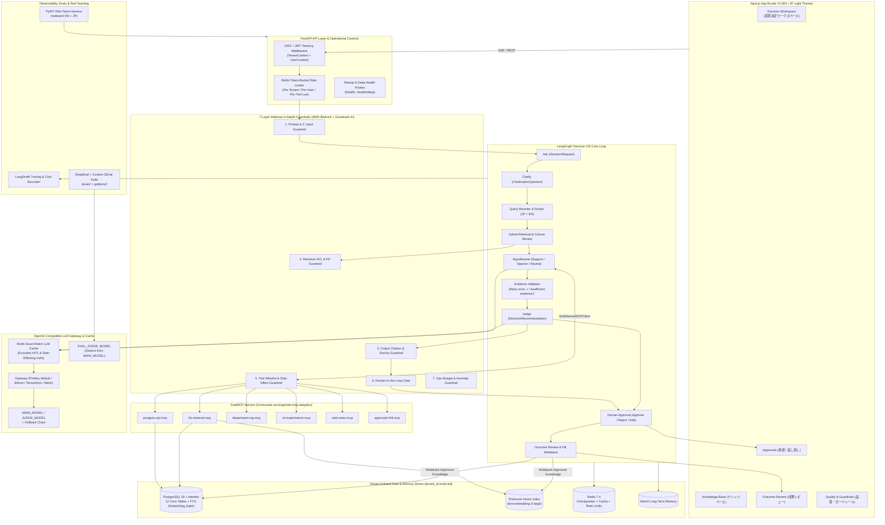

# ALBA ONE — System Architecture (`docs/ARCHITECTURE.md`)

**Product:** ALBA ONE — Enterprise Decision OS (`意思決定OS`)
**Company:** ALBACONNECT Inc. (Tokyo; ISMS-certified — ISO/IEC 27001)

## 1. Product Pillars

ALBA ONE structures enterprise decision-making around three pillars (used verbatim in UI and docs):

1. **Business meaning and data (`業務の意味とデータの接続`)**: Entities (companies, products, equipment, vessels), relationships, ACL permissions, and decision metadata extracted from operational databases.
2. **Workflow-specific decision support (`業務ごとの判断支援`)**: Delivery planning, staffing, vessel allocation, and ML model-release decisions.
3. **Outcome and knowledge operations (`結果と知識の運用`)**: Decision history, variance reasons, and business measures reviewed by accountable owners and written back to the knowledge base.

## 2. Full Planned System Diagram (Mermaid)

## 3. Multi-Tenant Isolation Model (Principle 8)

Every boundary enforces `tenant_id`:
- **Database (`PostgreSQL`)**: All 12 core tables and operational demo tables carry a non-nullable, indexed `tenant_id` column. Queries use `select_for_tenant(Model, tenant_id)` and `assert_same_tenant(...)`.
- **Cache (`Redis`)**: Keys are namespaced as `alba:llm_cache:{tenant_id}:{model}:{prompt_version}:{input_hash}:{retrieval_hash}`.
- **Rate Limiting (`Redis`)**: Buckets are isolated under `alba:rl:{scope}:{tenant_id}[:{subject_id}]`.
- **LLM Gateway (`Portkey / Bifrost / TensorZero / Mesh`)**: Every call injects `tenant_id`, `task`, and `prompt_version` into gateway metadata headers (`x-portkey-metadata` and `x-alba-tenant-id`).
