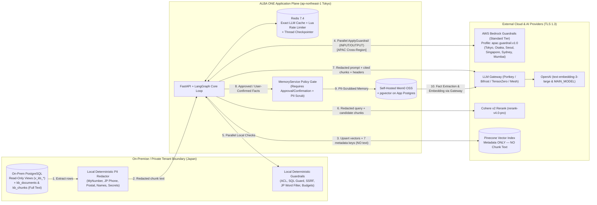

# ALBA ONE — Data Flows & Trust Boundaries (`docs/DATA_FLOWS.md`)

## 1. Cross-Boundary Data Flow Diagram (Mermaid)

## 2. Boundary Crossing Inventory Table

| Data Crossing Boundary | Source -> Destination | Leaves Japan (`ap-northeast-1`)? | Encryption | Retention | PII & Safety Controls Applied Before Crossing |
| :--- | :--- | :--- | :--- | :--- | :--- |
| **1. Vector Embeddings & Metadata** | On-Prem Indexer -> Pinecone (`namespace=tenant_id`) | Yes (Pinecone cloud region) | TLS 1.3 in transit; AES-256 at rest | Until chunk deleted/re-indexed | **No chunk text is sent to Pinecone** (`assert_pinecone_metadata_safe`). Only `chunk_id, tenant_id, acl_tags, entity_type, lang, valid_from, valid_to`. |
| **2. Chunk & Query Text for Embedding** | Indexer / Retriever -> LLM Gateway -> OpenAI (`text-embedding-3-large`) | Yes (Provider endpoint) | TLS 1.3 | Zero data retention (enterprise API policy) | `PIIRedactor` scrubs My Number, JP phones, `〒` postal codes, emails, and configured names on-premise first. |
| **3. Guardrail Evaluation Payloads** | API (`guardrails/bedrock.py`) -> AWS Bedrock (`ApplyGuardrail` with `apac.guardrail.v1:0`) | **Yes — APAC Cross-Region** (`ap-northeast-1/2/3`, `ap-south-1`, `ap-southeast-1/2`) | AWS internal TLS 1.3 | Stateless API call (not stored by Bedrock) | Local `PIIRedactor` and secret linter run in parallel; sensitive fields masked before downstream persistence. |
| **4. Candidate Chunks for Reranking** | Retriever (`reranker.py`) -> Cohere v2 (`/v2/rerank`) or Gateway | Yes (Provider endpoint) | TLS 1.3 | Stateless API call | Retriever guardrail drops ACL-unauthorized and prompt-injected chunks and masks PII before reranking. |
| **5. Prompts, Retrieved Chunks & Tool Summaries** | Agents / Judge / Mem0 OSS -> LLM Gateway -> LLM Provider | Yes (Provider endpoint) | TLS 1.3 | Gateway audit log + zero provider training retention | 7-layer guardrails (Prompt, Input, Retriever, Tool, Output, HITL, Ops) + pre-Mem0 PII scrubbing in `MemoryService`. |
